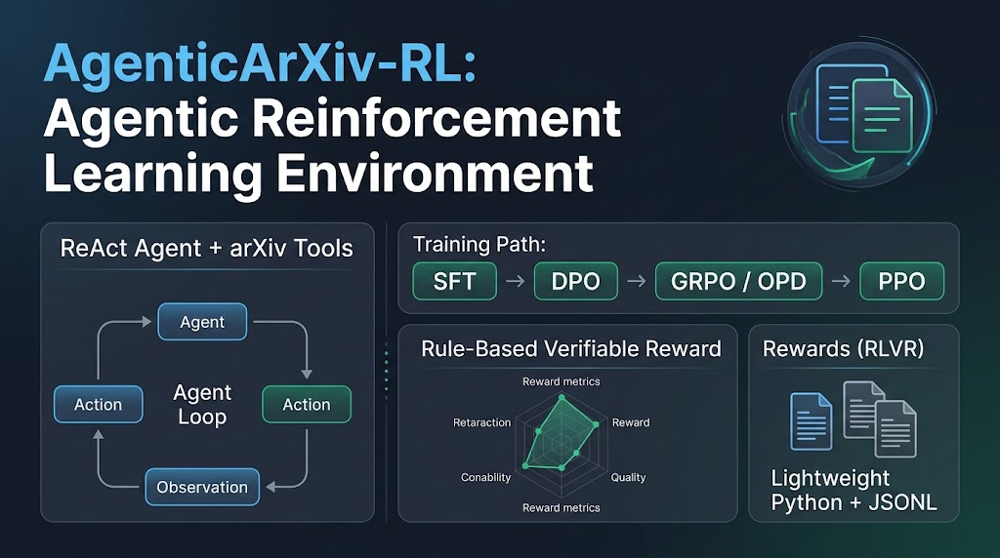

<p align="center">
  <a href="README.md">🇨🇳 中文</a> | <a href="README.en.md">🇬🇧 English</a> | <a href="README.es-ES.md">🇪🇸 Español</a>
</p>

# AgenticArXiv-RL — Agentic RL 训练环境

> **基于 ReAct Agent + arXiv 工具的 Agentic RL 训练环境**
> 默认训练主线为 SFT → GRPO，显式可选 SFT → DPO → GRPO；普通推理与评测统一使用文本 ReAct 和可验证奖励（RLVR）。
> 终极目标：**端侧部署的轻量多模态论文助手**——从检索、下载、翻译到总结、识图的端到端论文阅读模型。

<p align="center">
  
</p>

---

## 🎯 项目定位

将 arXiv 论文检索/下载/翻译/解读任务改造为**可训练的强化学习环境**，专注于：

1. **Verifiable Reward**：基于规则化奖励（工具调用准确度、任务完成度、解析错误等），无需人类标注
2. **直接训练主线与可选偏好阶段**：默认 SFT → GRPO，可选 SFT → DPO → GRPO；默认 QLoRA，也支持显式全参资源策略
3. **轻量级工程**：纯 Python + JSONL 存储，无数据库、无前端，专注离线训练

**非目标**：生产级 arXiv 应用、Web UI、实时翻译服务（原 Web 应用已从本仓库移除，见原版 [AgenticArXiv](https://github.com/Algorineko/AgenticArXiv)）。

### 已退出的 Jev 实验（历史记录）

Jev 路由与配置入口已退出，现仅支持普通文本 ReAct。历史 GRPO Qwen mixed 10-task、repeat=3 小样本中，guided Jev 的 strict success 为 40%→60%，本地 Qwen token 减少 74.01%，总延迟增加 36.96%；这是原小样本结构记录，不代表完整 81 题总体胜率，也不是本次重跑结果。退出范围见 [JEV_ROUTER.md](JEV_ROUTER.md)。

---

## 快速开始

以下安装命令从仓库根目录执行，使用 `.venv`，不含前端或数据库步骤。安装后可从任意目录调用 `agentic-arxiv`，无需设置 `PYTHONPATH`。

```bash
git clone https://github.com/Algorineko/AgenticArXiv-RL.git
cd AgenticArXiv-RL
python3 -m venv .venv
source .venv/bin/activate
pip install .

agentic-arxiv evaluate rollout --help
agentic-arxiv evaluate run --help
agentic-arxiv run --help
```

基础安装支持外部 API 和历史记录读取，不强制安装本地模型或训练栈。本地推理/评测与 DPO 数据生成安装 `pip install '.[local]'`，SFT/DPO/GRPO 训练安装 `pip install '.[train]'`。API 推理需要显式设置 `LLM_BASE_URL`、`LLM_API_KEY` 和 `MODEL`；不要提交真实 `.env` 或凭据。本地模型训练/评测不要求 API key。真实 PDF 翻译按需安装 `pip install '.[translate]'`，不启动异步应用服务。

全局 `--workspace` 默认当前工作目录；相对配置、模型、数据、快照和输出路径均相对于工作区，绝对路径保持原义。从其他目录使用已有研究输入时，将 `agentic-arxiv --workspace /实际工作区` 放在子命令前；缺失输入不会回退搜索源码目录。`.env` 只在实际操作时从工作区读取，帮助不会读取凭据或创建日志。新旧入口映射见 [架构迁移说明](docs/architecture_migration.md)。

```bash
# 后续另行运行已有本地模型和快照；本次未执行
agentic-arxiv evaluate rollout \
  --task-id search_01 --output-dir traces/react_messages \
  --model outputs/sft_qlora/final --offline \
  --snapshot data/mock_arxiv_snapshot.json --max-iterations 6
```

普通 `run` 默认 API/live；`evaluate rollout` 默认 offline，显式 `--no-offline` 才使用 live 工具。快照模式与模型后端相互独立，完整契约见 [运行时说明](docs/react_runtime.md)。

执行任务需要已有模型或可用 API；离线工具回放需要已有快照，缺失不自动联网补齐。安装/帮助检查与真实任务执行不同，本次没有调用外部 API、运行训练或模型评测。

---

## 📚 核心概念

### MDP 设计

| 维度 | 定义 |
|------|------|
| **State** | 任务描述 + 对话历史 + 工具结果 |
| **Action** | 10 个工具（见下）+ FINISH |
| **Reward** | 五分量多粒度可验证奖励（format / tool / argument / process / outcome） |
| **Transition** | `execute_tool(action) → observation`（`MockArxivEnv` 离线快照回放，确定性可复现） |

### 动作空间（10 个工具）

1. `get_recently_submitted_cs_papers(aspect, days, max_results)` — 按子领域+时间窗浏览
2. `search_arxiv_papers(query, max_results, days=None)` — 关键词/标题/作者检索
3. `download_arxiv_pdf(ref)` — 下载 PDF
4. `translate_arxiv_pdf(ref)` — 翻译 PDF（pdf2zh）
5. `get_paper_cache_status(ref)` — 查询缓存状态
6. `get_paper_content(ref, section=None)` — 读取摘要或指定章节（确定性抽取）
7. `summarize_paper(ref, style, max_words)` — env 侧摘要（tldr / structured / bullet）
8. `extract_paper_figures(ref)` — 抽出图表文件与 caption
9. `analyze_figure(ref, figure_no, question=None)` — 图表分析：env 侧调本地 VLM 读图（多模态环境启用）
10. `get_translated_content(ref, page=1)` — 按页读取译文（翻译后的中文 PDF，确定性抽取；第 1 页通常是标题与摘要）

> 以上列出常用业务参数，完整 schema 以工具注册表为准；`session_id` 由执行边界注入，不写入策略 Action 或 SFT 标签。

> **历史原协议能力记录，未在新协议下重跑。** 「检索 → 下载 → 阅读 → 总结 → 抽图 → 识图」解读闭环已全部打通：识图由本项目后训练的 [FigureQA VLM](https://www.modelscope.cn/models/Algorineko/AgenticArXiv-RL-Qwen3-VL-4B-FigureQA) 在 env 侧完成并录制快照，策略侧有学会该四步链的 [SFT-T5](https://www.modelscope.cn/models/Algorineko/AgenticArXiv-RL-Qwen2.5-1.5B-SFT-T5) 权重。
> **准入原则**：动作空间不是越大越好——新增工具的准入标准是「能开启一类新任务」，而不是「可能有用」。设计决策链见 [工具集演进设计](docs/toolset_evolution.md)。

### Verifiable Reward（五分量）

**多粒度可验证奖励**（`src/agentic_arxiv/scoring/reward.py`）。五个分量归一化到 `[-1, 1]`，另有诊断分量与不可补偿的失败上限：

| 分量 | 默认权重 | 信号 |
|------|:---:|------|
| `format` | 1 | 每步 action 是否为合法 JSON 工具调用或终止符 |
| `tool` | 3 | 预测与期望工具序列的**顺序感知 LCS-F1** |
| `argument` | 2 | 参数键召回率 × 精确值准确率 |
| `process` | 1 | 合法步骤加分 − 解析/执行失败/多余调用惩罚 |
| `outcome` | 3 | 正确完成 +1、路径错误完成 +0.25、强制停止 −0.5、错误 −1 |
| `result_quality` / `efficiency` | 诊断 gate | observation 是否真实成功；严重冗余触发 reward 上限 |

- **课程学习**：源码默认前 30 步将 `tool`/`argument`/`outcome` 权重乘 1/3（`RewardCalculator.schedule`），未因工程清理改成 0。历史实测记录为 SFT 起点 format 0.983、课程两臂对照不可区分；若未来显式覆盖 `--reward-curriculum-steps 0`，manifest 必须记录该覆盖，不能把它称为保留默认值。
- **非补偿性失败**：解析失败、执行失败、虚假 FINISH 最多得负奖励，不得靠格式分抵消；`analyze_figure` 缺有效答案时总奖励上限 −0.75。
- 所有奖励 **rule-based 可验证**（RLVR），每条轨迹记录 `reward_components` 明细，便于审计。判定细则见 [多粒度奖励文档](docs/multigranular_rl.md)。

### 轨迹隔离

每个 episode 持有独立会话状态和产物目录，快照与预取资产只读共享。reset/close 仅清理自身拥有的目录，不能清扫其他轨迹或用户文件。完整任务默认允许 6 轮，FINISH 占一轮；结束请求不等于任务成功。

---

## 统一消息协议

当前唯一协议为 `react-runtime-v2` / `react-messages-v3`：初始 user 建立任务/工具/实际 setup，后续 assistant 与环境 user Observation 交替，环境内容明确是数据。SFT 只监督当前 completion；DPO 在完全一致的实际完整消息下，只比较未截断的真实当前 assistant 决策，不补 FINISH、不截历史；GRPO 保留原采样 ID，policy mask=1、环境/插入边界 mask=0，严格比较 token 前缀、保留已有 EOS，rollout 不再次按 G 扩增。

旧/未知数据或需延续训练的模型产物不能自动标成兼容，训练协议检查不能由跳过 manifest 开关绕过。报告分开记录实际执行版本与来源模型真实训练版本，关系为 same_protocol/cross_protocol/unknown；未知不是同口径复现。真实 tokenizer 前缀、梯度与模型能力本次未验证。完整说明见 [运行时契约](docs/react_runtime.md)。

## 训练主线：默认 SFT → GRPO，可选 DPO

以下是后续另行执行的命令，不是本次工程验收步骤。需要新协议 SFT 数据及 manifest、基座模型/训练资源、离线快照；本次不生成这些输入，也不运行训练。

先安装 `pip install '.[train]'`。默认训练配置来自包资源 `agentic_arxiv/resources/mainline.json`，新增独立 DPO 节，原 SFT/GRPO 默认与来源子树不变；旧配置缺整个 DPO 节时在内存补默认，不写回文件。显式 `--config` 覆盖包默认，显式 CLI 参数再覆盖配置。

```bash
# 默认 QLoRA SFT；GRPO 直接消费其适配器和基座元数据
agentic-arxiv train sft \
  --data data/sft/sft_react_messages_v3_train_mix.jsonl \
  --output-dir outputs/sft_qlora

agentic-arxiv train grpo \
  --model outputs/sft_qlora/final \
  --task-set expanded --split data/splits/v7_86.json:train \
  --snapshot data/mock_arxiv_snapshot.json --max-turns 6

# 显式全参路径；不要把适配器输出误当作全参模型
agentic-arxiv train sft \
  --data data/sft/sft_react_messages_v3_train_mix.jsonl \
  --no-qlora --output-dir outputs/sft_full
agentic-arxiv train grpo \
  --model outputs/sft_full/final \
  --no-qlora --task-set expanded --split data/splits/v7_86.json:train \
  --snapshot data/mock_arxiv_snapshot.json --max-turns 6
```

正式 GRPO 必须显式绑定任务集及 `FILE:NAME` 训练切分；`--smoke` 是显式 8 任务模式，不隐式训练全部 86 条任务。历史 `v6_grpo_train.json:rl_train` 的 33 条与 `v7_86.json:train` 的 55 条不是同一训练集。

小型主线配置保全源码显式值、默认值及条件传参，不把未设置的损失、重要性采样或奖励缩放字段猜填为某版库默认值，也不宣称历史配方等价。缺模型、数据或必要元数据明确失败，不回退到其他模型/API。数据生成、扩增、混合、资源覆盖、消息/mask 和兼容说明见 [主线指南](docs/rl_building.md)。

训练保护保留长度检查、方差诊断、Canary、SFT 可解析率阈值 ≥ 0.3、GRPO mean reward 阈值 ≥ −0.2、精度和日志检查。验证消费完整 episode，而不是首步正确就算成功；真实模型通过这些阈值本次未验证。

SFT/DPO/GRPO 的 QLoRA 也支持单机 DDP，每卡一个进程。`python -m agentic_arxiv.training.launch` 启动器支持显式 GPU、各 rank 日志及无副作用的 `--dry-run`；四卡 batch/累积换算、GRPO 跨 rank 分组和验证边界见 [多卡训练指南](docs/training_distributed.md)。本次未启动真实多卡训练，不影响已有单卡任务。

### 容器化实验管理

`agentic-arxiv experiment --help` 提供轻量管理入口，覆盖六组配方、只读登记、单作业启动、状态与日志、安全停止、完整 checkpoint 恢复和独立评测。管理端只需基础安装，不连接远程服务器、不自动补跑前置阶段。配方支持预先声明总优化步数或 epoch 预算，恢复继续原预算并写入新尝试目录，不覆盖旧产物。

操作见 [命令与配置](docs/experiment-cli.md)、[输入与配方](docs/experiment_inputs.md)、[容器准备](docs/container-deployment.md) 和 [本地验证及未验证矩阵](docs/containerized-experiment-validation.md)。工程测试通过不等于实际训练镜像、GPU 容器或三阶段单卡/四卡恢复已通过；服务器操作和真实训练仍需独立授权。

### 显式可选 DPO（示例未执行）

不选择该阶段时，GRPO 仍默认读取 `outputs/sft_qlora/final`，不查找 DPO 目录或自动串接训练。生成只使用当前协议本地 SFT、已有快照及显式版本化 expanded `:train`，不接受留出集、裸 train 或历史 `rl_train` 子集：

```bash
agentic-arxiv data dpo generate \
  --model outputs/sft_qlora/final \
  --task-set expanded --split data/splits/v7_86.json:train \
  --snapshot data/mock_arxiv_snapshot.json \
  --output data/dpo/dpo_react_messages_v3_train.jsonl
agentic-arxiv train dpo --model outputs/sft_qlora/final \
  --data data/dpo/dpo_react_messages_v3_train.jsonl --inspect-only
agentic-arxiv train dpo --model outputs/sft_qlora/final \
  --data data/dpo/dpo_react_messages_v3_train.jsonl \
  --snapshot data/mock_arxiv_snapshot.json --output-dir outputs/dpo
agentic-arxiv train grpo --model outputs/dpo/final \
  --task-set expanded --split data/splits/v7_86.json:train \
  --snapshot data/mock_arxiv_snapshot.json --max-turns 6
```

`--inspect-only` 审计数据/轨迹哈希、训练成员、来源、协议、实际 tokenizer 前缀/目标与完整长度，不加载策略权重或训练；仍需本地 tokenizer。超长或模板边界不兼容直接失败，不截断。每任务最多一对，完整轨迹奖励只作偏好排序，不是单步因果证明；报告任务产出率和请求组合接受率两个分母，低产出仅报警，零对保留轨迹/失败报告并非零退出，不发布成功训练包。

DPO 的 policy/reference 独立来自同一完整 SFT，参考保留 SFT adapter 并冻结，不共享可变参数；双模型增加显存，`--no-qlora` 显式全参，不自动换参考。epochs 3、lr `5e-6`、beta 0.1、QLoRA batch 1/累积 8 是设计默认，不是已验证历史配方。默认完整多轮 Canary 验证报告奖励、严格成功率、解析率、虚假完成率、终止/覆盖及协议关系；阈值失败保留模型/报告并非零退出，`--no-verify` 记 skipped 而非 PASS，不自动进入 GRPO。训练完成、冒烟验证通过和优于 SFT 分开表述。详见 [主线指南](docs/rl_building.md)；本次没有生成数据、训练或模型评测，真实 tokenizer、参考优化后不变、GPU/DDP 与收益未验证。

OPD、PPO、GRPO 变体选择、自进化、独立 VLM 后训练、Jev、MCP/Skill CLI、Web/HTTP、MySQL/SSE 活动入口仍退出；恢复 DPO 不恢复旧脚本、旧导入或旧数据兼容。图表工具既有推理后端、快照构建、T5 backfill、坏例评分和外部 LLM API 保留。

### 历史发布结果（原协议，未重跑）

下列发布信息和数值保留原实验口径，不表示新消息协议下的当前模型能力。新协议训练拒绝不兼容输入，跨协议评测须明确标注。

> 已发布：[AgenticArXiv-RL-Qwen2.5-1.5B-SFT](https://www.modelscope.cn/models/Algorineko/AgenticArXiv-RL-Qwen2.5-1.5B-SFT)（Qwen2.5-1.5B 全参，2 epoch / 2628 条专家轨迹，loss 0.079；只覆盖前 8 个工具）。

> 已发布：[AgenticArXiv-RL-Qwen2.5-1.5B-GRPO](https://www.modelscope.cn/models/Algorineko/AgenticArXiv-RL-Qwen2.5-1.5B-GRPO)（33 条信号任务，全程离线快照回放）。离线评测（seed 45 / repeat 3，严格成功率 pass³）SFT → GRPO：**rl_train 0.081→0.636，dev 0.000→0.375，iid_test 0.056→0.444，ood_test 0.000→0.500**。

> 已发布：[AgenticArXiv-RL-Qwen3-VL-4B-FigureQA](https://www.modelscope.cn/models/Algorineko/AgenticArXiv-RL-Qwen3-VL-4B-FigureQA)（451 图 / 73 论文，按论文切分防泄漏；留出 94 图 ROUGE-1 0.105→0.126、ROUGE-L 0.081→0.102）。

---

## 📦 已发布模型

> **以下是历史已发布模型列表。** 不表示退出的变体仍可训练，也不保证旧 checkpoint 在新上下文中行为不变。

| 模型 | 基座 | 说明 |
|------|------|------|
| [AgenticArXiv-RL-Qwen2.5-1.5B-SFT](https://www.modelscope.cn/models/Algorineko/AgenticArXiv-RL-Qwen2.5-1.5B-SFT) | Qwen2.5-1.5B | 阶段1 全参 SFT（前 8 工具） |
| [AgenticArXiv-RL-Qwen2.5-1.5B-GRPO](https://www.modelscope.cn/models/Algorineko/AgenticArXiv-RL-Qwen2.5-1.5B-GRPO) | Qwen2.5-1.5B | 阶段3 GRPO（四切分评测见上） |
| [AgenticArXiv-RL-Qwen2.5-1.5B-GRPO-GSPO](https://www.modelscope.cn/models/Algorineko/AgenticArXiv-RL-Qwen2.5-1.5B-GRPO-GSPO) | Qwen2.5-1.5B | GRPO + 序列级重要性采样（四切分与基线持平，见范式对比文档） |
| [AgenticArXiv-RL-Qwen2.5-1.5B-GRPO-DrGRPO](https://www.modelscope.cn/models/Algorineko/AgenticArXiv-RL-Qwen2.5-1.5B-GRPO-DrGRPO) | Qwen2.5-1.5B | GRPO 无偏变体（rl_train 0.657 / dev 0.375 / iid 0.444 / ood 0.500，pass³） |
| [AgenticArXiv-RL-Qwen2.5-1.5B-GRPO-DAPO](https://www.modelscope.cn/models/Algorineko/AgenticArXiv-RL-Qwen2.5-1.5B-GRPO-DAPO) | Qwen2.5-1.5B | DAPO 目标、无动态采样（rl_train 0.667 / dev 0.500 / iid 0.481 / ood 0.500，pass³，三变体最优） |
| [AgenticArXiv-RL-Qwen2.5-1.5B-SFT-T5](https://www.modelscope.cn/models/Algorineko/AgenticArXiv-RL-Qwen2.5-1.5B-SFT-T5) | Qwen2.5-1.5B | SFT + `analyze_figure` 四步链（rl_train 0.485 / dev 0.250 / iid 0.278 / ood 0.250，pass³） |
| [AgenticArXiv-RL-Qwen3-VL-4B-FigureQA](https://www.modelscope.cn/models/Algorineko/AgenticArXiv-RL-Qwen3-VL-4B-FigureQA) | Qwen3-VL-4B | env 侧图表分析 VLM |

全部托管于 ModelScope（`Algorineko/AgenticArXiv-RL-*`），model card 含离线评测表与诚实限制说明。

---

## 🧪 任务集与评测

- **冒烟集**（`src/agentic_arxiv/tasks/tasks.py`）：8 条（search / download / translate / cache / composite）
- **扩展集**（`src/agentic_arxiv/tasks/tasks_expanded.py`）：86 条、十四类模板（search / keyword_search / ref_form / composite / state / optional / constraint / long_chain / infeasible / paper_reading / paper_summary / figure_extraction / figure_analysis / **translation_reading**），`agentic-arxiv evaluate run --task-set expanded` 启用。两套任务统一走 `TaskSpec`：`expected_tools` / `expected_tool_args` 由同一份 `steps` 派生，不出现两份手写列表漂移。
- **切分**：`data/splits/v7_86.json` 为 train 55 / dev 8 / iid_test 19 / ood_test 4；历史 `v6_grpo_train.json:rl_train` 为 33 条，不能混称。未来信号选择只从声明 train 产生新文件，dev/iid/ood 不参与训练；本次不重新测量 rates。
- **评测口径（数值为历史记录）**：`pass^k` 可靠性（tau-bench 口径）、`false_finish`（退化策略 `always_finish` 91.5% vs `reference` 0%）、`ref_score`（比 `paper_id` 而非 `ref` 写法）、代价按成功次数归一。
- **区分度闸门（历史统计）**（当前入口 `agentic-arxiv evaluate baselines`）：确定性退化策略逐类目卡门槛——「永远搜 cs.AI」在检索类 0.833→0.446，「本该不调工具却调了」+0.165→−0.235。
- **坏例回放**（`agentic-arxiv evaluate badcases replay` + `eval/eval_cases.jsonl`，17 条）：失败轨迹冻成永久回归用例，回放只跑打分器，`pytest` 即闸门；`hack/*` 记录骗分形态并配阈值断言，兼作 reward hacking 案例库。

```bash
agentic-arxiv evaluate run \
  --backend transformers --model outputs/grpo/final \
  --task-set expanded --split data/splits/v7_86.json:iid_test \
  --offline --snapshot data/mock_arxiv_snapshot.json \
  --repeat 3 --output artifacts/eval_react_messages_iid
```

---

## 依赖说明

唯一依赖声明为 [pyproject.toml](pyproject.toml)，安装与旧入口迁移见 [架构迁移说明](docs/architecture_migration.md)。基础 `pip install .` 包含 `arxiv`、`requests`、`python-dotenv`、`loguru`、`pydantic`、PyMuPDF 和 Pillow，不含训练栈。

- `pip install '.[local]'`：torch、transformers、accelerate、peft，用于本地推理、默认 LoRA 产物和按需模型工具，不安装训练器。
- `pip install '.[train]'`：包含 local 同约束依赖，再加 trl、datasets、bitsandbytes 和 packaging。
- `pip install '.[translate]'`：真实 PDF 翻译 pdf2zh。
- `pip install '.[logging]'`：训练曲线 tensorboard；wandb 可按既有方式单独安装并显式启用。
- `pip install '.[dev]'`：pytest、覆盖率、flake8、构建与元数据检查，不隐含 train。

训练库版本沿用声明与接口保护，本次不升级/降级；Fire 已退出。图表/摘要模型后端使用显式本地模型，缺少可选依赖时在实际使用时报错，不缩减完整 10 工具注册。帮助检查不加载真实 tokenizer、模型或训练器，也不证明其集成行为已经验证。Web、数据库和其他 Agent 架构依赖不是安装选项。

---

## 🔗 相关资源

- **文档**：[工具集演进设计](docs/toolset_evolution.md) · [多粒度奖励](docs/multigranular_rl.md) · [指标统计](docs/metric_stats.md) · [Roadmap 调研笔记](docs/roadmap_notes.md) · [TRL 文档](https://huggingface.co/docs/trl/)
- **方法论文**：RLVR；DPO (Stanford, 2023)；[On-Policy Distillation (Thinking Machines, 2025)](https://thinkingmachines.ai/blog/on-policy-distillation/)；[GKD (arXiv:2306.13649)](https://arxiv.org/abs/2306.13649)
- **原版**：[AgenticArXiv](https://github.com/Algorineko/AgenticArXiv)（Web 应用版，FastAPI + Vue3 + MySQL）

---

## 🤝 贡献

欢迎 Issue 与 PR！流程：Fork → feature 分支 → `pip install -e '.[dev]'` → `pytest tests/` → `feat:` 前缀提交 → PR。训练侧无模型回归另需 train 依赖，详见 [CONTRIBUTING.md](CONTRIBUTING.md)。

## 📄 License

MIT License

---

## 🙋 FAQ

**Q: 与原 AgenticArXiv 的区别？** 原版是生产级 Web 应用（FastAPI+Vue3+MySQL，三种 Agent 架构）；本项目是纯 Python + JSONL 的 RL 训练环境，只保留 ReAct 单策略，默认 SFT → GRPO、显式可选 DPO，推理使用文本 ReAct 可验证奖励。

**Q: 为什么选 GRPO 不用 PPO？** GRPO 无需 value model（显存开销小）、适合 1.5B 量级小模型、实现简单易调试；PPO 更适合生产级大模型训练。

**Q: 摘要/识图的质量为什么不进奖励？** 质量打分需要 LLM-as-judge，引入非确定性与 hacking 面。设计上把解读收敛为**工具调用决策问题**（何时调、对谁调、参数对不对）——全部规则可判、可复现，这是 RLVR 的前提。

---

## 历史 Roadmap（非当前待办）

> **以下为原方向记录，不是当前运行或实施计划。** 原数值、旧旗标及路径保留语境；已退出的入口不能运行，旧“待跑”条目不构成本次工程验收待办。当前未来命令与本次未执行边界见 [主线指南](docs/rl_building.md)。


> 完整论据与引入路径见 [docs/roadmap_notes.md](docs/roadmap_notes.md)。欢迎认领（见 🤝 贡献）。

### P0 — 端侧多模态论文助手（终极目标）

- [ ] **策略侧多模态化**：把 VLM 从 env 侧移进策略侧（observation 携带图表），复用 `train_vlm_figure_qa.py` 已验证的 TRL 视觉语言路径；候选基座 Qwen3-VL-4B / Qwen2.5-VL-2B（端侧档）
- [ ] **端到端阅读链**：检索 → 下载 → 翻译 → 总结 → 识图在单模型内闭环，面向端侧推理（量化 + 2-4B 量级）优化
- [x] **翻译正文入上下文**：新增 `get_translated_content`，按页确定性读取 pdf2zh 译文；离线快照回放（`build_snapshot --translate-max-ref N` 录制），按读类规则判定结果质量

### P1 — 新一代 Agentic RL 算法

- [x] **GSPO / Dr.GRPO 接线**：`--importance_sampling_level sequence`（序列级重要性采样，GSPO）与 `--loss_type dr_grpo`（无偏长度归一）已接入 `train_grpo.py`，与 `--dapo` 预设正交可组合
- [x] **新方法训练与对比**：GSPO / Dr.GRPO / DAPO 三变体已在冻结切分上完成对照训练并发布权重（公共配方对齐基线，seed 42 / 60 步；离线评测 pass³，基线 GRPO：rl_train 0.636 / dev 0.375 / iid 0.444 / ood 0.500）：
  - **GSPO**（序列级 IS）：0.636 / 0.375 / 0.444 / 0.500——与基线逐位持平（权重哈希不同、轨迹分化，行为收敛一致）
  - **Dr.GRPO**（无偏目标）：0.657 / 0.375 / 0.444 / 0.500——rl_train 略优，ood 工具准确率 0.67 / 虚假完成率 0.33 最优
  - **DAPO**（clip-higher 0.28 + 截断掩码 + β=0，33 任务池上动态采样不可行故关闭）：**0.667 / 0.500 / 0.481 / 0.500**——rl_train / dev / iid 三切分最优
  - 详情与实现注记见 `docs/rl_paradigm_comparison.md`
- [ ] **SAO 式异步训练**：迁移 verl `fully_async_policy` / AReaL，先引入 skip-observation 掩码与 DIS 双边裁剪（[arXiv:2607.07508](https://arxiv.org/abs/2607.07508)，官方代码未开源）
- [ ] **跨步信用分配**：GiGPO / ARPO 式组内跨步优势，缓解长程链的轨迹级稀疏信号（自研研究项）

### P2 — Jev 判别式决策组件

- [ ] **Jev 式判别头**：非自回归结构化决策（choice/score，成本 ~LLM 的 1/400），候选落点：① `result_quality` 判别头替代规则 ② 奖励分量路由器（替代固定课程表）③ 工具选择的结构化解码（封闭枚举天然适合判别式）。约束：确定性推理或只作诊断信号，保持 RLVR 可复现

### P3 — RSI 受限自进化（bounded RSI）

- [ ] **自进化数据闭环**：留出评测暴露弱点 → 坏例库自动扩容 → 参数化派生针对性数据 → 再训练 → 冻结新留出集（复用现有评测/数据/训练管线，前置件已齐）；验收：每轮四切分 pass³ 不回退、坏例库只增不减（[arXiv:2609.11873](https://arxiv.org/abs/2609.11873) 四步循环）。**编排器已落地**（`AgenticArxiv/rl/self_evolve.py`：diagnose → mine → select → synthesize → freeze → gate，纯 JSON、无需模型；`generate_parametric_sft_data.py --only-parents` 定向补数据），真实一轮训练与四切分对照待跑（见 [docs/roadmap_notes.md](docs/roadmap_notes.md)）

### ⛔ 环境阻塞项

- [ ] **vLLM 加速采样**：TRL 0.29 要求 vLLM 0.10.2–0.12.0，本机平台定制版 0.6.2 装在一起会让 GRPOTrainer import 失败。属环境依赖而非代码改动，待平台提供匹配构建。

---

**开始你的 Agentic RL 训练之旅！** 🚀
