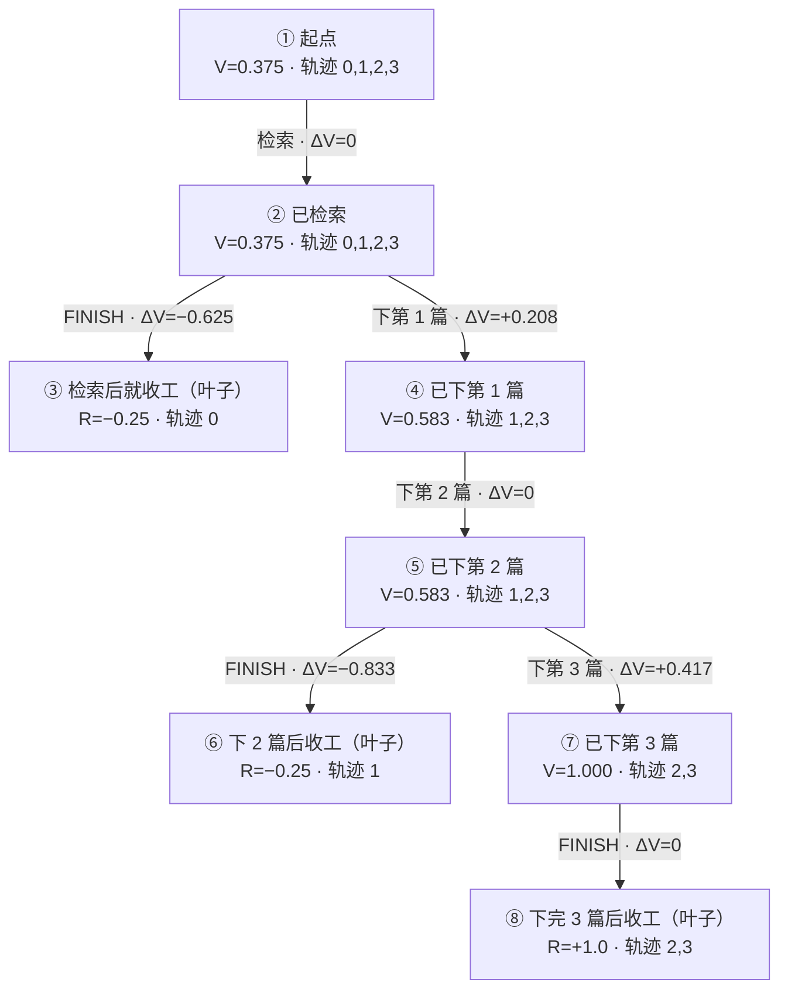

# 跨步信用分配：确定性前缀树上的步级优势

> 对应 Roadmap P1「跨步信用分配」。核心代码 `AgenticArxiv/rl/step_credit.py`（纯 Python，不依赖 torch），训练接入 `AgenticArxiv/rl/step_credit_trainer.py`（PR 2）。
> 文中所有数字都可以用 `python -m AgenticArxiv.rl.step_credit demo` 复现，不需要任何数据文件。

**一句话：** GRPO 把整条轨迹的一个优势值原样复制给每一步；本方法把同组 G 条轨迹按动作前缀拼成一棵树，在分叉处比较「同一局面下不同选择的平均结局」，把轨迹优势拆到真正改变结局的那几步上。拆完之后，每条轨迹各步之和仍严格等于 GRPO 原来给它的优势。

---

## 1. 为什么需要

### 1.1 GRPO 现在怎么给信用

同一任务采样 G 条轨迹（本项目 G=4），每条得到一个最终奖励 R_i，TRL 算出轨迹优势：

```
A_i = (R_i − 组均值) / (组内样本标准差 + 1e-4)
```

然后把这**一个数**乘到这条轨迹里所有模型生成的 token 上（`env_mask=1` 的部分）。这会带来三种错配：

- 做对的步骤，跟着失败的轨迹一起被压低；
- 真正出错的那一步，没有被单独指出来；
- 整组奖励相同时（例如都被封顶在 −0.25），优势全为 0，所有步骤一点信号都拿不到。

### 1.2 一个具体的例子

任务 `chain_ro5_dl_three`：「检索最近 7 天的 RO 论文（5 篇），然后下载前三篇」。某条轨迹做了「检索 → 下第 1 篇 → 下第 2 篇 → FINISH」：前三步都对，只是少下一篇就收工了，触发虚假完成封顶，奖励 −0.25。

在 GRPO 下，这条轨迹的 4 步**全部**拿到 −0.866，包括三个做对的步骤。本方法要做的，是让错误集中落在「过早 FINISH」这一步上，而把做对的步骤还给它们应得的信用。

### 1.3 本项目里的实测现象

- **封顶把不同进度的失败压成同一个分数。** 在上面的任务上，做对 1 步后收工的加权分是 +0.115，做对 3 步后收工是 +0.589，封顶后都是 −0.25。封顶是防骗分设计，不应放松；但它让奖励本身无法区分「差一点」和「差很多」。
- **零方差组占比高。** `data/splits/v6_grpo_train.json` 的冻结探测里，264 个 prompt 组只有 145 个（54.9%）有组内奖励方差。
- **长链失败集中在中后段。** 失败的位置多在第 2 到第 4 步，而不是第 1 步。

---

## 2. 核心概念

### 2.1 动作键：什么算「同一个动作」

每一步的动作被规范化成一个字符串，叫**动作键**（`canonical_action_key`）：

- 工具名 + 参数，参数按键排序；
- `aspect` 的大小写和 `cs.` 前缀统一（`cs.RO`、`ro` 都算 `RO`）；
- `ref` 用观察里实际解析出的论文 ID 代替（`ref=1` 和 `ref="2601.00001"` 指向同一篇时算同一个动作）；
- 去掉 `session_id`；
- FINISH、解析失败各有固定的键；
- **思考文本不进键。**

规范化刻意保守：只合并能证明等价的写法。漏合并只会让对照变少，错合并才会给出错误信号。

### 2.2 前缀树：每个节点代表什么

把同组 4 条轨迹的动作键序列叠在一起，就得到一棵前缀树。下面是 1.2 节任务的一组真实 rollout 形态：

- 轨迹 0：检索 → FINISH（奖励 −0.25）
- 轨迹 1：检索 → 下第 1 篇 → 下第 2 篇 → FINISH（奖励 −0.25）
- 轨迹 2、3：检索 → 下第 1 篇 → 下第 2 篇 → 下第 3 篇 → FINISH（奖励 +1.0）



一个**节点**是「依次做完某些动作之后、轮到模型写下一步时的那个局面」。可以从三个角度理解同一个节点：

| 角度 | 节点 ④ 的含义 |
|---|---|
| 一串动作（前缀） | [检索, 下第 1 篇] |
| 一个环境状态 | 模型已经看到：任务描述、检索返回的论文列表、第 1 篇下载成功的回执，正准备写第 3 步 |
| 一群轨迹 | 经过它的轨迹 {1, 2, 3} |

第二个角度能成立，靠的是**确定性快照回放**：`MockArxivEnv` 对同样的动作序列总是返回同样的观察，所以「动作前缀相同」就等于「环境状态相同」。这让我们不需要像 GiGPO 那样对观察做哈希匹配。

其他几个名词：

- **边** = 一个动作。
- **轨迹** = 从根走到叶子的一条路径。
- **分叉** = 同一局面下，不同轨迹做了不同选择（本例中是 ② 和 ⑤）。
- **叶子** = 轨迹结束的地方。

最关键的一点：**节点不是步，步是边。** 第 t 步是从节点 s_t 走到 s_{t+1} 的那条边，所以每一步的信用都由它两端的节点算出。

### 2.3 价值 V(s)：这个局面平均能走到多好

定义很直接：

```
V(s) = 所有经过节点 s 的轨迹，最终奖励的平均值
```

本例中：

| 节点 | 经过的轨迹 | V |
|---|---|---|
| ①、② | 0、1、2、3 | (−0.25 − 0.25 + 1 + 1) / 4 = 0.375 |
| ④、⑤ | 1、2、3 | (−0.25 + 1 + 1) / 3 ≈ 0.583 |
| ⑦ | 2、3 | 1.0 |

通俗地说，V(s) 回答的是：**「从这个局面出发，按模型现在的水平继续做下去，最后平均能拿多少分？」** 它像棋类引擎里某个局面的胜率，看的是结局，而不是已经挣了多少。

需要记住的四点：

1. 本项目只在最后给奖励，所以价值就是「期望的最终得分」。
2. 价值依赖当前模型：模型变了，同一局面的价值也会变。
3. 它只是少量样本的估计，比较粗糙；节点越深，经过的轨迹越少。
4. **根节点的价值就是组均值**，也正是 GRPO 用的基线。可以说 GRPO 只看根的价值，本方法看路径上每个节点的价值。

### 2.4 ΔV：这一步让结局变好还是变坏

```
ΔV_t = V(第 t 步之后的节点) − V(第 t 步之前的节点)
```

更直观的读法是：

- V(之后的节点) = 在这个局面下**选了这个动作的人**的平均得分；
- V(之前的节点) = **所有到达这个局面的人**的平均得分。

所以 **ΔV = 「选这个动作」比「这个局面下的平均选择」好多少**。这正是强化学习里「优势」的含义，只是按步来算。

以分叉 ② 为例：4 条轨迹到这里，1 条选了 FINISH（平均 −0.25），3 条选了下第 1 篇（平均 0.583），整体平均 0.375。

- ΔV(FINISH) = −0.25 − 0.375 = **−0.625**
- ΔV(下第 1 篇) = 0.583 − 0.375 = **+0.208**

按人数加权正好抵消：1 × (−0.625) + 3 × (+0.208) = 0。**在分叉处，一方多得的就是另一方少得的。**

没有分叉的地方（① 处 4 条都检索，④ 处 3 条都下第 2 篇），前后人群相同，ΔV = 0。这不表示「这一步没价值」，而是**组内没有对照，没有证据判断它**。

### 2.5 归一化

```
A_t = ΔV_t / (组内奖励样本标准差 + 1e-4)
```

分母和 GRPO 完全相同（样本标准差，与 `torch.std` 默认一致），只是为了让数值与 GRPO 处在同一尺度。

### 2.6 叶子约定：最后一步落在自己的真实得分上

对每条轨迹的**最后一步**，「之后」的值不取节点均值，而取**这条轨迹自己的最终奖励 R_i**。

在 2.2 节的例子里这条规则没有区别，因为三个叶子各自只包含同分的轨迹。它在两种情况下起作用：

**情况一：动作相同，分数不同。** 不可行任务 `infeasible_unknown_id`（下载一篇快照里不存在的论文）的正确做法是直接 FINISH 并说明原因。假设两条轨迹的思考写了「快照中不存在该论文，无法下载」（奖励 +1.0），另两条写「任务已完成」（奖励 −0.25）。四条的动作键都只是 `FINISH`，树只有根和一个子节点。

- 不用叶子约定：子节点均值 0.375 等于根，四条的 ΔV 都是 0，「说没说明原因」的差别完全丢失。
- 用叶子约定：每条得到 R_i − 0.375 = ±0.625，归一化后 ±0.866，与 GRPO 一致。

差别藏在思考文本里，而动作键看不到思考文本，唯一能记录它的地方就是最后一步。

**情况二：被截断的轨迹恰好是另一条的前缀。** 不用叶子约定，被截断轨迹的最后一步会拿到节点均值，信用凭空多出或少掉一块，下一节的守恒就不成立了（7.1 节有算例）。

### 2.7 守恒：只重新分配，不增不减

**每条轨迹各步信用之和 = 这条轨迹的 GRPO 优势。** 原因是差值首尾相消，就像爬山时每段的海拔变化加起来只取决于终点减起点：

```
ΔV_1 + ΔV_2 + … + ΔV_T
= [V(s_1) − V(s_0)] + [V(s_2) − V(s_1)] + … + [R_i − V(s_{T−1})]
= R_i − V(s_0)
= R_i − 组均值
```

- 起点永远是根，根的价值就是组均值；
- 终点永远是 R_i，这正是叶子约定保证的。

再除以同一个标准差，就与 GRPO 的 A_i 完全相同。

此外还有两层平衡：在每个分叉处，经过它的人之间信用相互抵消；整组所有轨迹的总和为 0，与 GRPO 一致。

需要说清楚**什么不守恒**：GRPO 是把 A_i **复制**给每一步，T 步就有 T 份；本方法是把**一个** A_i **拆分**给各步。所以守恒的是「这条轨迹相对组均值的净得分」，不是「推动模型的总力度」。纯分解（w=1）时，没有分叉的步拿到 0，单步幅度大约是 GRPO 的 1/T。

守恒的意义：

- 方法不凭空制造信号，也不丢信号：比组均值差的轨迹，整体仍然是负的，方向与 GRPO 一致；
- 它是一次纯粹的「重新分配」，可以干净地和 GRPO、打乱对照比较；
- 它可以当作工程检查：训练器把最大守恒误差写进日志，不为零就说明有 bug。

---

## 3. 完整算例

继续 2.2 节那组轨迹。组均值 0.375，样本标准差约 0.722。标注「叶子」的行用轨迹自己的 R 作为「之后」的值。

**轨迹 0**（检索 → FINISH，奖励 −0.25）

| 步 | 动作 | 之前 | 之后 | ΔV | A = ΔV / 0.722 |
|---|---|---|---|---|---|
| 1 | 检索 | ① 0.375 | ② 0.375 | 0 | 0 |
| 2 | FINISH | ② 0.375 | 叶子 R = −0.25 | −0.625 | **−0.866** |
| 合计 | | | | −0.625 | −0.866 |

**轨迹 1**（下 2 篇后收工，奖励 −0.25）

| 步 | 动作 | 之前 | 之后 | ΔV | A |
|---|---|---|---|---|---|
| 1 | 检索 | ① 0.375 | ② 0.375 | 0 | 0 |
| 2 | 下第 1 篇 | ② 0.375 | ④ 0.583 | +0.208 | **+0.289** |
| 3 | 下第 2 篇 | ④ 0.583 | ⑤ 0.583 | 0 | 0 |
| 4 | FINISH | ⑤ 0.583 | 叶子 R = −0.25 | −0.833 | **−1.155** |
| 合计 | | | | −0.625 | −0.866 |

**轨迹 2、3**（全部完成，奖励 +1.0）

| 步 | 动作 | 之前 | 之后 | ΔV | A |
|---|---|---|---|---|---|
| 1 | 检索 | ① 0.375 | ② 0.375 | 0 | 0 |
| 2 | 下第 1 篇 | ② 0.375 | ④ 0.583 | +0.208 | **+0.289** |
| 3 | 下第 2 篇 | ④ 0.583 | ⑤ 0.583 | 0 | 0 |
| 4 | 下第 3 篇 | ⑤ 0.583 | ⑦ 1.000 | +0.417 | **+0.577** |
| 5 | FINISH | ⑦ 1.000 | 叶子 R = 1.0 | 0 | 0 |
| 合计 | | | | +0.625 | +0.866 |

和 GRPO 对比：

| | GRPO 给每一步 | 本方法 |
|---|---|---|
| 轨迹 1 的「下第 1 篇」（做对了） | −0.866 | **+0.289** |
| 轨迹 1 的 FINISH（过早收工） | −0.866 | **−1.155** |
| 轨迹 2 的「下第 3 篇」（关键一步） | +0.866 | **+0.577** |
| 轨迹 2 的「下第 2 篇」（大家都这么做） | +0.866 | 0 |

几个值得注意的地方：

- **同一局面、同一动作，信用相同。** 「下第 1 篇」在轨迹 1 和轨迹 2 里都是 +0.289，轨迹 1 后面的失误没有把它拖下来。
- **离成功越近，放弃越亏。** 轨迹 0 在 ② 停下，FINISH 扣 −0.866；轨迹 1 在 ⑤ 停下，扣 −1.155。因为在 ⑤ 继续做的人全部成功了，在那里停下损失的期望分更多。
- **单步信用的绝对值可以大于整条轨迹的总和**，因为其他步的正信用（+0.289）抵消了一部分。

---

## 4. 模块 B：整组同分时，用规则进度补信号

**问题。** 当组内 4 条奖励完全相同（例如全被封顶在 −0.25），GRPO 的优势全是 0，模块 A 也全是 0。但这 4 条轨迹的进度其实可能不同：有的做对了 1 步，有的做对了 3 步。

**做法。** 每一步本来就可以按任务的标准步骤逐条判对错，所以可以定义一个**规则进度**：

```
Φ = 按顺序严格匹配的标准步数 / (标准步数 + 1)        （FINISH 算最后一步）
```

只有当**组内奖励零方差、而 Φ 有方差**时，才用 Φ 代替奖励建同一棵前缀树：

```
A_t = β · [V_Φ(s_{t+1}) − V_Φ(s_t)] / (σ_Φ + 1e-4)
```

叶子约定同样适用（最后一步落在自己的 Φ_i 上），所以各步之和等于 β·(Φ_i − 组均值 Φ)/(σ_Φ + 1e-4)。

**例子（demo 里的 `all_early_stop` 组）。** 4 条轨迹全部提前收工，奖励都是 −0.25：

| 轨迹 | 动作 | Φ | 各步 A |
|---|---|---|---|
| 0 | 检索 → FINISH | 0.2 | 0, **−0.783** |
| 1 | 检索 → 下 1 → FINISH | 0.4 | 0, **+0.783**, **−0.522** |
| 2 | 检索 → 下 1 → 下 2 → FINISH | 0.6 | 0, **+0.783**, **+0.522**, 0 |
| 3 | 检索 → FINISH | 0.2 | 0, **−0.783** |

GRPO 在这组里一个信号都没有；模块 B 告诉模型「在这一局面下，继续下载比收工好」。

注意轨迹 2 的 FINISH 拿到 0：在「已下 2 篇」这个局面只有它一条轨迹，没有对照（见 7.2 节）。

**为什么只在零方差组启用。** 模块 B 不修改奖励、不碰封顶，只在 GRPO 本来没有任何信号的组里补充方向。有奖励方差的组完全由真实奖励决定。

---

## 5. 写回 token 与训练接入

> 本节的训练器子类（`rl/step_credit_trainer.py`）和训练参数随 PR 2 提交；token 区间的记录（`turn_token_spans`）已在 PR 1 中加入 `rl/grpo_reward.py`，默认不改变任何训练行为。

### 5.1 怎么铺到 token 上

rollout 时记录每一轮模型生成的 token 在 completion 里的区间 `turn_token_spans[t] = [start, end)`，它与 `history[t]` 一一对应。第 t 步区间内每个 token 的优势为：

```
A_tok = (1 − w) · A_traj + w · A_t
```

- 观察 token 和 padding 保持 A_traj，它们本来就被 `env_mask` / `completion_mask` 排除在损失之外；
- **w = 0 时与原 GRPO 逐位一致**，w = 1 时是纯分解；
- 模块 B 生效的组里 A_traj 本来就是 0，所以 token 优势就是 w · A_t。

### 5.2 与 TRL 的归一化对齐

TRL 的 `scale_rewards` 有 group / batch / none 三种。训练器拿到 TRL 实际算出的轨迹优势后，用 `align_step_advantages` 为每组求一个缩放系数，使各步之和等于 TRL 给的轨迹优势，并把最大守恒误差写进日志（`step_credit/*`）。

### 5.3 新增的训练参数（`rl/train_grpo.py`）

| 参数 | 默认 | 说明 |
|---|---|---|
| `--step_credit {off,reward,progress}` | `off` | `off` 为原 GRPO，不构造收集器、不换训练器类；`reward` 只用模块 A；`progress` 用模块 A + B |
| `--step_credit_weight` | 0.5 | 公式中的 w，取值 [0, 1] |
| `--step_credit_beta` | 1.0 | 模块 B 的系数 β |
| `--step_credit_shuffle` | 关 | 打乱对照：同一轨迹内随机换位步优势，总量与集中度不变，用来检验收益是否真的来自「找对了那一步」 |

配置写进 `training_manifest.json` 的 `step_credit` 字段。

---

## 6. 与现有选项的兼容性

| 选项 | 能否同时使用 | 说明 |
|---|---|---|
| `--dapo`、`--loss_type` | 可以 | 逐 token 优势与损失聚合方式正交 |
| `--importance_sampling_level sequence`（GSPO） | 可以，但不推荐作为主线 | 序列级比率与裁剪会让一步的裁剪牵连整条序列；GSPO 在本项目中作为已完成的对照变体 |
| `--scale_rewards none / batch` | 可以 | `align_step_advantages` 自动对齐 |
| `--dynamic_sampling` | 可以 | 只记录被接受的 batch |
| `--qlora` | 可以 | 对照各臂必须同为全参或同为 QLoRA |
| `accelerate launch` 多卡 | v1 不支持 | 多进程下同组样本会被分到不同进程，收集器拼不出完整的组；初始化时报错 |
| `--allow_zero_variance` | 建议开启 | 否则方差守护可能在模块 B 生效前就停训 |

---

## 7. 已知局限

### 7.1 截断

观察 token 也计入 `max_completion_length`（默认 256）。如果第一轮检索的观察就用完了预算，rollout 在第 1 步后被截断，前缀树只有一层，后面的步骤无从分解。**这个问题排在信用分配前面**，`scripts/check_completion_budget.py` 用来检查。

截断还会和叶子约定相互作用。把例子里的轨迹 1 改成「检索 → 下 1 → 下 2 后被截断」（奖励 +0.439，截断不触发虚假完成封顶），组均值变成 0.547，V(④) = V(⑤) = 0.813：

- 被截断轨迹的「下第 2 篇」= 0.439 − 0.813 = **−0.374**，而轨迹 2 在同一局面做同一动作拿到 0；
- 轨迹 2、3 的「下第 3 篇」各拿 +0.187，尽管在 ⑤ 没有人真正选过别的动作。

「被截断」不是树上的动作，它的代价落在了最后一个真实的、本身正确的步骤上，并像一条虚假的分支一样影响其他轨迹。截断普遍时，这类信用会主导结果。所以应当先修预算，再谈信用分配。

### 7.2 单样本节点

每组只有 4 条轨迹，越深的节点越可能只剩一条，那里的步骤拿到 0。`report` 命令会统计这类节点的占比。

### 7.3 笃定型错误

如果 4 条轨迹在同一步犯同一个错，树上没有分叉，模块 A、B 都无能为力。这属于探索或数据覆盖问题。`scripts/step_entropy_probe.py` 可以诊断首错步是「犹豫型」（有分叉、本方法有用）还是「笃定型」。

### 7.4 奖励本身的风险偏好

提前 FINISH 封顶 −0.25，尝试后报错封顶 −0.75。如果某个局面下继续往下走的轨迹多数报错，它们的平均分会低于 −0.25，模块 A 就会判定「停下更好」。这是奖励设计的取向，信用分配只是把它精确地传到那一步。

### 7.5 token 数加权

损失是逐 token 累加的，一步的信用乘在这一步的所有 token 上。思考写得长的步，实际权重更大。

### 7.6 规模

33 条训练任务、1.5B 模型。是否有效需要四切分对照实验来回答，结论要写清样本量和种子数。

---

## 8. 与已有研究的关系

| 工作 | 思路 | 与本方法的关系 |
|---|---|---|
| GiGPO（arXiv 2505.10978） | 用跨轨迹重复出现的「锚状态」构造步级组，轨迹优势 + ω · 步级优势 | Roadmap 点名的方法。本方法在确定性回放下做精确状态匹配；用拆分而非叠加，因此严格守恒 |
| TreeRL（arXiv 2506.11902）、Tree-GRPO（arXiv 2509.21240） | 在树上做组相对优势 | 模块 A 的局部优势与之同类 |
| SALT（arXiv 2510.20022） | 同组轨迹建图，计算步级优势 | 与模块 A 最接近 |
| RTMC（arXiv 2604.11037） | 在 rollout 树上用组内统计估计每步 Q 值和优势，不需要 critic | 思路高度接近；它声称能处理纯前缀方法处理不好的情况 |
| GACA（arXiv 2609.12424） | 按步自适应地混合步级与轨迹级信用 | 本方法的 w 是固定值，自适应混合可作为后续方向 |
| IGPO、AgentPRM、SPA-RL | 用信息增益或进度给中间步打分 | 模块 B 用规则直接判定进度，不训练额外模型 |
| PURE（arXiv 2504.15275） | 求和式过程奖励容易诱导骗分 | 本方法用首尾相消的差值，并保留结局奖励 |

**新颖性的诚实评估。** 模块 A 基本是上述树/图方法的组合，并不新；模块 B 的成分也有先例。可能有价值的是这个组合在本项目里的落地：不可补偿的防骗分封顶下只对零方差组启用规则进度、精确守恒的分解、基于确定性回放的精确状态匹配，以及能用逐步标准答案直接衡量「信用准确率」。

---

## 9. 怎么用

```bash
# 演示（不需要数据文件）
python -m AgenticArxiv.rl.step_credit demo

# 离线诊断：读取 train_grpo --rollout_trace_path 写出的审计文件
python -m AgenticArxiv.rl.step_credit report --traces outputs/xxx/rollouts.jsonl --explain 3

# 截断检查：一条正确轨迹需要多少 completion token
python scripts/check_completion_budget.py --tokenizer <分词器目录> \
  --snapshot data/mock_arxiv_snapshot.json \
  --split data/splits/v6_grpo_train.json:rl_train --budget 256

# 训练（PR 2 之后可用）
python -m AgenticArxiv.rl.train_grpo --model <起点模型> \
  --step_credit progress --step_credit_weight 0.5 --allow_zero_variance
```

性质与测试的对应（`AgenticArxiv/tests/test_step_credit.py`、`test_step_credit_scripts.py`，共 27 条）：

| 性质 | 测试 |
|---|---|
| 各步之和等于轨迹优势（守恒） | `test_deltas_conserve_to_value_minus_mean`、`test_reward_mode_conserves_grpo_advantage` |
| 同局面同动作拿到相同信用 | `test_same_action_same_state_gets_same_credit_before_the_end` |
| 模块 B 只在奖励零方差时启用 | `test_progress_only_when_reward_is_flat`、`test_progress_never_runs_when_rewards_differ` |
| 规则进度的判定 | `test_repeating_a_correct_step_freezes_progress`、`test_finishing_beats_not_finishing`、`test_tool_failure_is_not_progress`、`test_blocked_task_needs_explained_finish` |
| 动作键只合并可证明等价的写法 | `test_thought_and_aspect_spelling_do_not_change_the_key`、`test_refs_resolving_to_the_same_paper_share_a_key`、`test_terminal_and_parse_errors` |
| w = 0 时与 GRPO 逐位一致 | `test_zero_weight_reproduces_grpo` |
| 对齐 TRL 的 `scale_rewards` | `test_alignment_follows_trainer_scale` |
| rollout 记录的 token 区间恰好覆盖模型生成的 token | `test_spans_cover_exactly_the_policy_tokens` |
| reward 函数把结果交给收集器；挂上收集器前后返回的奖励逐位相同 | `test_reward_fn_feeds_the_collector`、`test_collector_does_not_change_rewards` |
